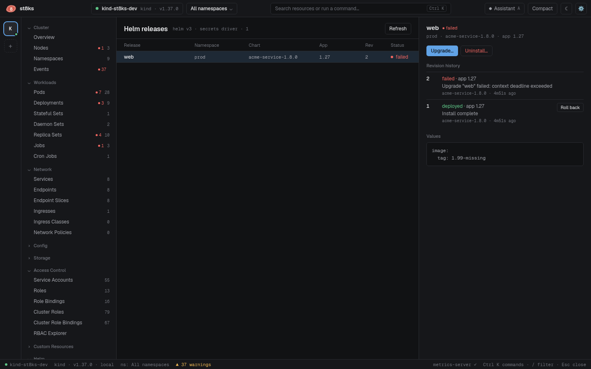

# Helm releases

Open **Helm > Releases** to see every Helm 3 release in the selected namespaces. The list refreshes every 10 seconds. To install a chart from a chart repository or from an OCI registry, click **Install chart…**.



## Release details

Click a release. The side panel shows:

- The status, the chart and the app version.
- The revision history with the status and description of each revision.
- The user-supplied values of the current revision, like `helm get values`.
- The release notes of the chart.

## Roll back

1. Click **Roll back** next to a revision.
2. Check **Dry run first** to render the revision without a change, or leave it clear.
3. Click **Roll back**.

A rollback creates a new revision from the old one. Chart hooks run. This is the same as `helm rollback RELEASE REVISION`.

## Upgrade with new values

1. Click **Upgrade…**. An editor opens with the current user-supplied values.
2. Change the values.
3. Click **Dry run** to render the chart with the new values.
4. Click **Upgrade**.

The upgrade uses the chart that the release already stores, so no chart repository is needed. The new values replace the old user-supplied values, like `helm upgrade --reset-values -f values.yaml`. To change the chart version, use the Helm CLI.

## Uninstall

Click **Uninstall…** and type the release name to confirm. st8ks deletes every resource of the release, except resources with the `helm.sh/resource-policy: keep` annotation.

## Install a chart

1. Click **Install chart…**.
2. Find the chart:
   - To use a chart repository, type a part of the chart name, a keyword or a word of the description. The list shows the newest stable version of each chart that matches. Press the arrow keys to move in the list, and press Enter to select a chart.
   - To use an OCI registry, paste the reference, for example `oci://ghcr.io/stefanprodan/charts/podinfo`, and press Enter.
3. Select the version. The newest stable version is the default. To see alpha, beta and release candidate versions, check **Prereleases**.
4. Enter the release name. The default is the chart name.
5. Enter the namespace. The default is the first selected namespace, or else the namespace of the context. **Create namespace** is checked when the namespace does not exist.
6. Optional: Check **Wait for ready** and set the timeout. Check **Atomic** to uninstall the release when the install fails.
7. Edit the values on the **Values** tab. The editor starts with the `values.yaml` of the chart. The **Changes** tab shows a diff against the defaults.
8. Click **Dry run**. The **Manifest** tab shows the rendered objects and hooks, and the count of resources.
9. Click **Install**, then click **Install** in the confirmation dialog. A protected namespace or context needs the release name typed first.

After the install, the releases list selects the new release and shows the notes of the chart. If the namespace of the release is not selected, st8ks adds it to the namespace selection.

This is the same as:

```sh
helm install podinfo podinfo/podinfo --version 6.17.0 -n demo --create-namespace -f values.yaml
helm install podinfo oci://ghcr.io/stefanprodan/charts/podinfo -n demo
```

The **README** tab shows the README of the chart as simple Markdown. Click **Plain text** to see the source. The **Chart** tab shows the facts from `Chart.yaml` and the dependencies. A dependency that is missing from the chart archive stops the install.

### Values

st8ks stores only the values that differ from the chart defaults, like `helm install -f` with a short values file. Comments and unchanged lines do not go into the release. To remove a default value, set it to `null`. Click **Reset to the defaults** to discard your edits.

When you select a different version, st8ks loads the defaults of that version. If you did not edit the values, the editor shows the new defaults. If you edited them, your edits stay and the **Changes** tab compares them with the new defaults.

### Dry run

The dry run renders the chart like `helm install --dry-run=server`, so `lookup` functions read the cluster. Then st8ks sends each rendered object, hooks included, to the API server with `dryRun=All`. The API server validates each object and runs the admission webhooks, but stores nothing. The **Manifest** tab lists every object that the API server refuses.

When the namespace does not exist yet, the API server cannot check the objects in it. The dry run then checks only the cluster-scoped objects and tells you so. A dry run also fails when the release name is in use in the namespace.

## Repositories

**Helm > Repositories** lists the chart repositories from your local Helm configuration, the same list as `helm repo list`.

To change the list, click **Repositories** in **Helm > Releases**:

- To add a repository, enter a name and the URL, then click **Add**. Check **The repository needs a login** to enter a user name and a password. st8ks downloads the index first, so a wrong URL never goes into the list. This is the same as `helm repo add NAME URL`.
- To download the newest index, click **Update** next to a repository, or **Update all**. This is the same as `helm repo update`.
- To remove a repository, click **Remove**. st8ks deletes its cached index. Installed releases do not change. This is the same as `helm repo remove NAME`.

An OCI registry has no index, so you cannot add it as a repository. Paste the `oci://` reference in the chart search instead.

## Files and credentials

st8ks uses the same files as the `helm` CLI, so a change in one shows in the other:

| File | Default on Linux | Variable |
| --- | --- | --- |
| Repository list | `~/.config/helm/repositories.yaml` | `HELM_REPOSITORY_CONFIG` |
| Repository cache with the indexes and the chart archives | `~/.cache/helm/repository` | `HELM_REPOSITORY_CACHE` |
| Registry logins | `~/.config/helm/registry/config.json` | `HELM_REGISTRY_CONFIG` |

To install from a private OCI registry, log in with the Helm CLI first:

```sh
helm registry login ghcr.io
```

st8ks also reads the Docker credentials, like Helm. It never shows a password or a token in an error.

The search reads the cached index of each repository once and keeps it in memory until the file changes. After the first load, a search reads no files. Each call to a repository or a registry stops after 60 seconds.

## How st8ks reads releases

Helm stores each revision in a Secret with the label `owner=helm`. To be fast, st8ks lists only the Secrets that are not superseded and decodes the newest revision of each release. The detail panel decodes the full history of one release. Install, rollback, uninstall and upgrade use the Helm SDK.

st8ks reads releases that the `secret` storage driver stores. This is the Helm default.
