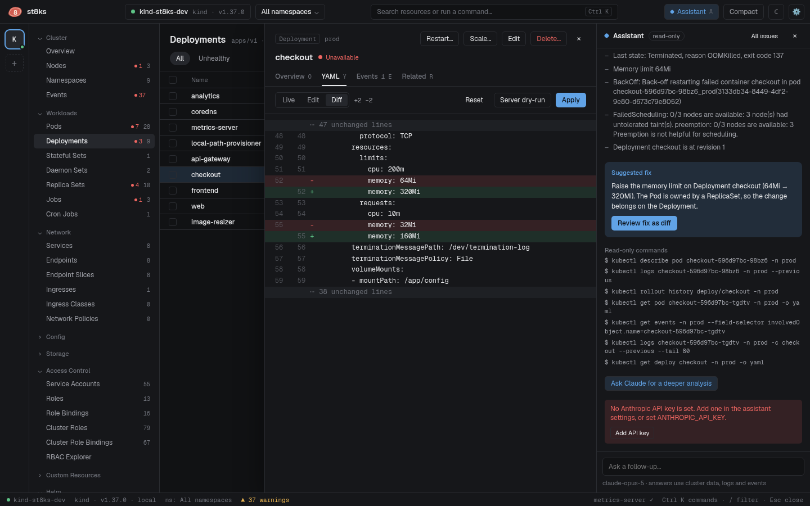

# Issues and the assistant

st8ks checks the cluster for common problems all the time. Each problem is an issue with a summary, evidence, a suggested fix and the read-only commands that show the same data. Issues show on the overview, in the events view, in the pod overview and in the assistant panel.

## What st8ks detects

| Issue | Severity | Evidence | Fix action |
| --- | --- | --- | --- |
| A container is in `CrashLoopBackOff` after an OOM kill | Error | Last state, exit code, memory limit, current use, warning events, Deployment revision. The assistant also gets the peak memory of the last hour from [Prometheus](metrics.md#assistant-evidence). | **Review fix as diff**: raises the memory limit on the owning workload |
| A container is in `CrashLoopBackOff` for another reason | Error | Last state, exit code and what it means, warning events | **Open previous logs** |
| An image cannot be pulled | Error | Pull errors from events. A missing tag or rejected credentials are named. | **Roll back Helm release** when a Helm release manages the workload |
| A container cannot be created | Error | The error, for example a missing Secret | None |
| A pod cannot be scheduled for 30 seconds | Warning | The scheduler message, pod requests, cordoned nodes | **Uncordon NODE** when a cordoned node is ready |
| A node is not ready | Error | The Ready condition | None |
| A node has memory, disk or PID pressure | Warning | The condition message | None |
| A Deployment rollout is stuck | Error | The Progressing condition | None |
| A StatefulSet older than 5 minutes is not fully ready | Warning | Ready replicas and revisions | None |
| A Job failed in the last 24 hours | Warning | The Failed condition and failed pods | None |
| A PersistentVolumeClaim is pending for 2 minutes | Warning | Provisioning events | None |
| A cert-manager Certificate is not ready | Warning | The Ready condition | None |
| An Argo CD Application failed its last sync, or has a condition of a type that ends in `Error` | Error | The operation message and the failed resources, or the condition message | **Sync**, or **Refresh** for a condition |
| An Argo CD Application is `Degraded` | Error | The health message and the degraded resources | **Sync** |
| An Argo CD Application is `Missing`, or is `OutOfSync` for 2 minutes without a sync in progress | Warning | The missing resources, or the resources that are out of sync | **Sync** |
| A Flux object is `Stalled`, or its `Ready` condition is `False` | Error | The conditions, and each source that is not ready | **Reconcile** |
| A Flux object stays in `Ready` `Unknown` for 10 minutes | Warning | The `Ready` condition | **Reconcile** |
| A suspended Flux object fails | Warning | The conditions | **Resume** |

st8ks checks these Flux kinds: Kustomization, HelmRelease, GitRepository, OCIRepository, HelmRepository, HelmChart and Bucket. One Argo CD Application or Flux object gives one issue. See [GitOps](gitops.md) for the rules in detail.

Pods of the same workload group into one issue. For example, two crashing replicas of `checkout` are one issue with "2 pods · 12 restarts".

A pod issue hides the matching rollout issue, so one cause shows once.

## Fix actions

Every action asks for a confirmation or shows a diff first:

- **Review fix as diff** opens the owning Deployment, StatefulSet or DaemonSet in the YAML diff. The proposed limit is twice the current limit, and at least 256 MiB more. The request goes up to half of the new limit when it is lower. Run a server dry run, then click **Apply**.
- **Uncordon NODE** opens a confirmation. The pending pod can then schedule on the node.
- **Roll back Helm release** finds the last revision that deployed or was superseded before the current one, and opens a confirmation.
- **Sync** sets the `operation` field of an Argo CD Application, like `argocd app sync`. **Refresh** sets the annotation `argocd.argoproj.io/refresh`. A checkbox selects a hard refresh.
- **Reconcile** sets the annotation `reconcile.fluxcd.io/requestedAt` on a Flux object, like `flux reconcile`. For a HelmRelease, a checkbox also sets `reconcile.fluxcd.io/forceAt`. **Resume** sets `spec.suspend` to `false`.

The GitOps actions are the same as the actions in the detail panel, and they support a server dry run.

After the action, the assistant shows "Applied. Watching for recovery…". The issue disappears when the cluster recovers.

## Assistant

Press `a`, click **Assistant** in the top bar, or click **Explain** next to an issue. The panel lists the open issues. Click one to see its evidence and fix.

**Explain** also asks Claude for a deeper analysis. You can ask follow-up questions in the box at the bottom. Without a selected issue, the questions go with a summary of the cluster.

The assistant is read-only. It cannot run commands or change the cluster. Every fix goes through the same confirmations as a manual change.

To let Claude Code investigate an issue with the st8ks tools, click **Open in Claude Code** on the issue. Claude Code runs in the dock and needs no API key in st8ks. See [MCP server and Claude Code](mcp.md).

### What the assistant sends

For an issue, st8ks sends these data to the Claude API:

- The issue, its evidence and the suggested fix.
- The YAML of the object, and of its owner, without `managedFields`.
- The events of the object, up to 12.
- The last 80 log lines of each container. For a container that restarted, these are the lines from before the restart.

For a question about the whole cluster, st8ks sends the context name, the distribution, node and pod counts, requests, and the list of issues.

The panel shows the read-only commands that return the same data, so you can check them.

### Set up the assistant

The assistant needs an API key for the Claude API. Create one in the [Anthropic Console](https://console.anthropic.com/settings/keys). A Claude subscription token, which starts with `sk-ant-oat`, does not work.

st8ks uses the first credential it finds:

1. The API key in Settings > Assistant. st8ks stores it in the settings file, which only your user can read. This key always goes to `api.anthropic.com`. st8ks ignores `ANTHROPIC_BASE_URL` and `ANTHROPIC_AUTH_TOKEN` for it.
2. The `ANTHROPIC_API_KEY` environment variable, with `ANTHROPIC_BASE_URL` when it is set.
3. A login with the `ant` CLI.

To check the setup, click **Test** in Settings > Assistant. st8ks also runs the test after you save a key. The result shows the reason when the key does not work, as the Anthropic API reports it.

The default model is `claude-opus-5`. Change it in Settings > Assistant. When the model declines a request, the API serves it again with the recommended fallback model.
