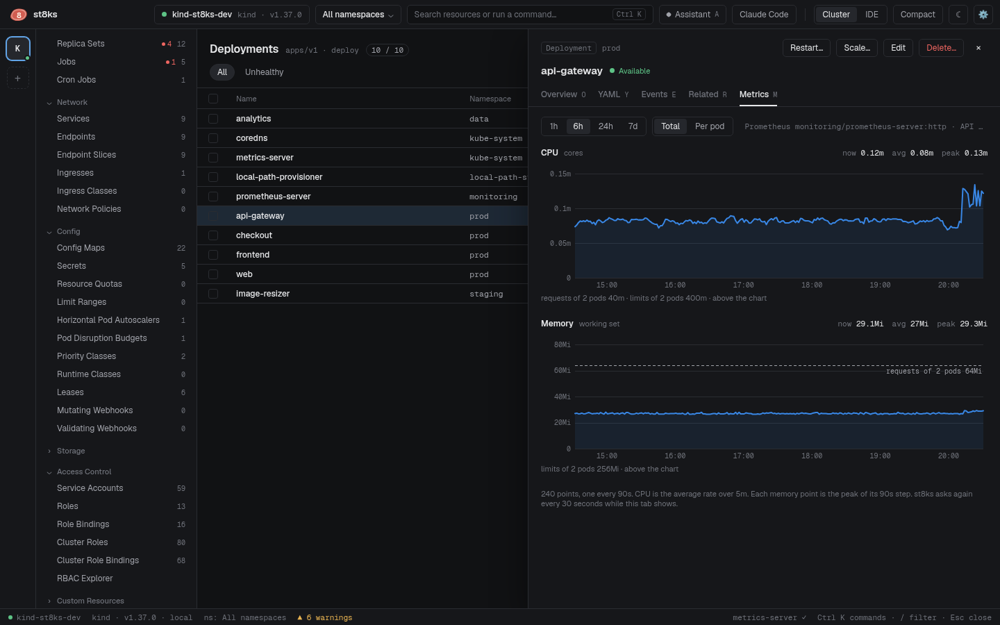

# Metrics history

The **Metrics** tab shows the CPU and memory history of a pod, a Deployment, a StatefulSet, a DaemonSet or a node. The data comes from the Prometheus or VictoriaMetrics of the cluster. st8ks queries it through the API server with your kubeconfig credentials, so you need no port-forward.

The list columns and the overview cards still use metrics-server. They show the current value only.



## Open the tab

1. Open a pod, a workload or a node in the detail panel.
2. Click **Metrics**, or press `m`.

Select a range: **1h**, **6h**, **24h** or **7d**. st8ks keeps the range for the next object.

The tab asks Prometheus when it opens, and again every 30 seconds while it shows. Nothing polls in the background. A query that takes more than 10 seconds stops with an error.

## Charts

| Object | CPU and memory | Lines |
| --- | --- | --- |
| Pod | One line for each container. **Total** shows the sum of the containers. | The request and the limit of the container. **Total** shows the sum of all containers. |
| Deployment, StatefulSet, DaemonSet | **Total** shows the sum of all pods. **Per pod** shows one line for each pod. | Per pod: the request and the limit of the pod template. Total: the same values times the replica count of the current spec. |
| Node | The whole node | The requests of the pods on the node, and the allocatable capacity |

- CPU is in cores. It is the average rate of `container_cpu_usage_seconds_total` over 5 minutes, or over one step when the step is longer.
- Memory is `container_memory_working_set_bytes`. This is the value that the kubelet compares with the memory limit. For a range with a step longer than 1 minute, each point is the peak of its step, so a short spike stays visible.
- A dashed line is a request, in gray, or a limit, in red. A line far above the data does not move the scale. Its value then shows below the chart.

A chart has at most 240 points. The step is the range divided by 240, rounded up to 15 seconds:

| Range | Step |
| --- | --- |
| 1h | 15 seconds |
| 6h | 90 seconds |
| 24h | 6 minutes |
| 7d | 42 minutes |

Move the pointer over a chart to read the values at that time. Both charts show the same time. To read the values with the keyboard, focus a chart with `Tab` and use `←` and `→`.

With more than one line, a table below the chart gives the current value, the average and the peak of each line. **Per pod** shows the 7 pods with the highest peak. **Total** includes all pods.

### Pods of a workload

st8ks finds the pods of a workload with a regular expression on the pod name, so pods that are already deleted still count:

| Workload | Pod names |
| --- | --- |
| Deployment `web` | `web-` + the ReplicaSet hash + `-` + 5 characters, for example `web-7d9f8b6c4-x2k9p` |
| StatefulSet `redis` | `redis-0`, `redis-1` and so on |
| DaemonSet `kindnet` | `kindnet-` + 5 characters |

### Nodes

Node history needs cAdvisor series that name the node. st8ks reads the root cgroup with the label `node` or `instance`, or the sum of the containers with the label `node`. The prometheus-community chart and kube-prometheus-stack both work. When no series match, the tab says that node history is not available.

## Find Prometheus

When the setting is **Auto**, st8ks searches the Services of the cluster on first use, and remembers the result for the context. It reads the Services from its watch cache, so the search costs no API call.

| Source | Services | Path |
| --- | --- | --- |
| kube-prometheus-stack, kube-prometheus | `*-kube-prometheus-prometheus`, `prometheus-k8s`, `prometheus-operated` | |
| prometheus-community chart | `prometheus-server`, `*-prometheus-server` | |
| VictoriaMetrics single | `vmsingle-*`, `*victoria-metrics-single-server` | |
| VictoriaMetrics cluster | `vmselect-*`, `*-vmselect` | `/select/0/prometheus` |
| Any | The label `app.kubernetes.io/name` set to `prometheus`, `vmsingle` or `vmselect` | |

st8ks skips Alertmanager, exporters, operators, Grafana and Thanos. When more than one Service matches, st8ks prefers the namespace `monitoring`. It picks the port named `web`, `http-web` or `http`, then the port 9090, 8428, 8481 or 80, then the only port.

When your credentials cannot list Services in all namespaces, st8ks searches only the namespaces `monitoring`, `prometheus`, `observability`, `victoria-metrics`, `vm`, `kube-prometheus` and `openshift-monitoring`.

## Set the source

When discovery finds the wrong Prometheus, or none, set it in **Settings > Metrics**:

| Mode | Value | Connection |
| --- | --- | --- |
| Auto | Empty | The API server proxy to the Service that st8ks finds |
| Service | `namespace/name:port`, with an optional path | The API server proxy to that Service |
| URL | `http://` or `https://` and a host | A direct connection, without the cluster credentials |

Examples:

```text
monitoring/prometheus-server:80
monitoring/kps-kube-prometheus-prometheus:http-web
vm/vmselect-main:8481/select/0/prometheus
http://localhost:9090
```

The port can be a name or a number. Without a port, st8ks picks one from the Service. Click **Test** to send one query to the source.

## Permissions

A query through the API server proxy needs `get` on `services/proxy` in the namespace of the Service. To check it, run:

```sh
kubectl auth can-i get services --subresource=proxy -n monitoring
```

When the permission is missing, the tab names it. Ask your cluster admin for it, or set a URL that you can reach directly. A Role that grants it for one Service follows. The name of a proxy request includes the port, as the source line of the tab shows it.

```yaml
apiVersion: rbac.authorization.k8s.io/v1
kind: Role
metadata:
  name: prometheus-query
  namespace: monitoring
rules:
- apiGroups: [""]
  resources: [services/proxy]
  resourceNames: [prometheus-server, "prometheus-server:http"]
  verbs: [get]
```

## Assistant evidence

For a crash loop after an OOM kill, the assistant context gets one more line from Prometheus, for example:

```text
Memory working set peaked at 63.8Mi of the 64Mi limit in the last hour
```

st8ks adds the line only when Prometheus answers within 3 seconds. Otherwise the context has no such line, and no error shows. Prometheus samples at an interval, so it can miss a short spike before the kill. When the peak is below 80 % of the limit, the line says so.

## States

| The tab shows | Cause | Next step |
| --- | --- | --- |
| No Prometheus found | Discovery found no matching Service. The tab lists what st8ks looked for. | Set the source in **Settings > Metrics**. |
| No permission to query Prometheus | The proxy request is forbidden. The tab names the missing permission. | Get `get` on `services/proxy`, or set a URL. |
| No data for this object | Prometheus has no series for the object in the range. A pod that never started has none. | Select a longer range, or check that Prometheus scrapes cAdvisor. |
| The query failed | Prometheus or the proxy returned an error, or no answer came in 10 seconds. The tab shows the error text. | Check the source in **Settings > Metrics**. |

## Try it on the local cluster

```sh
make cluster-up
make cluster-prometheus
```

`make cluster-prometheus` installs the server of the prometheus-community chart in the namespace `monitoring`. See [Development](development.md#prometheus).
